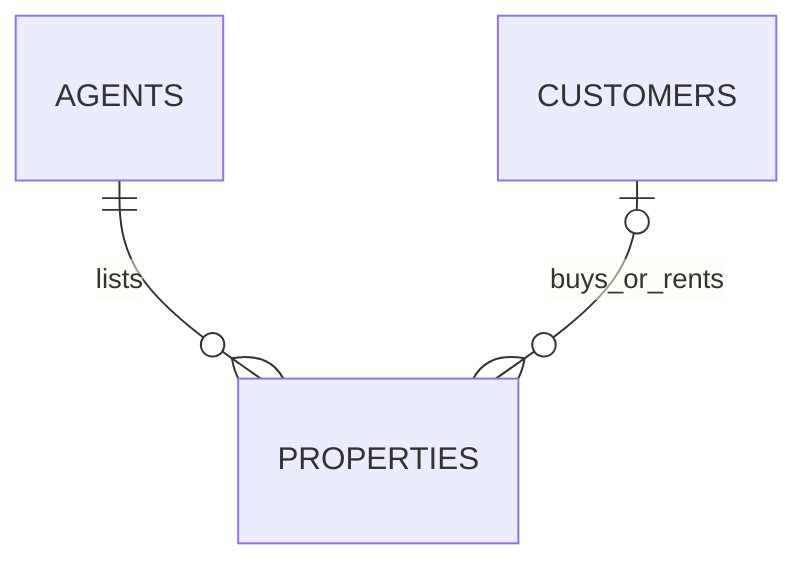

# Real Estate Property Analytics (SQL Project)

Sample SQL database for real estate analytics: **20 agents, 180 customers (200 people) and 250 properties** across Pune, Mumbai, Nashik and Nagpur. All data is synthetic.

## Files
- `real_estate_sample_data.sql`: creates the tables, loads the data, includes starter queries

## Tables
- **agents**: `agent_id` (PK), name, gender, email, phone, city, hire_date, experience_yrs, commission_pct, status
- **customers**: `customer_id` (PK), name, gender, age, email, phone, city, customer_type (Buyer/Renter/Investor/Seller), budget_inr, registration_date, lead_source
- **properties**: `property_id` (PK), `agent_id` (FK), `customer_id` (FK, NULL if unsold), type, listing_type (Sale/Rent), city, locality, bedrooms, bathrooms, area_sqft, year_built, furnishing, listing_price_inr, final_price_inr, listing_date, closing_date, status

## Relationships
- One agent lists many properties
- One customer can buy or rent many properties (optional until a deal starts)



## Setup
```bash
mysql -u <user> -p <db> < real_estate_sample_data.sql      # MySQL
psql -U <user> -d <db> -f real_estate_sample_data.sql      # PostgreSQL
sqlite3 real_estate.db < real_estate_sample_data.sql       # SQLite
```
The script drops and recreates `agents`, `customers` and `properties` on every run.

## Example Query
```sql
-- Revenue by agent
SELECT a.agent_id, a.first_name, COUNT(*) AS deals, SUM(p.final_price_inr) AS total_value
FROM agents a JOIN properties p ON p.agent_id = a.agent_id
WHERE p.status = 'Sold'
GROUP BY a.agent_id, a.first_name
ORDER BY total_value DESC;
```

## Analysis Ideas
Agent performance, price per sq ft by locality, discount from listing price, lead-source effectiveness, unsold inventory.
